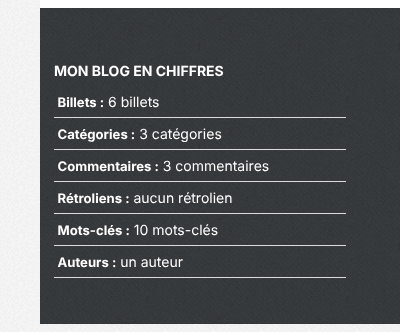
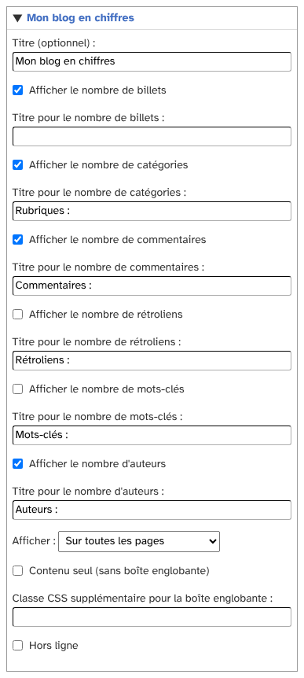

# myBlogNumbers : guide d'utilisation

myBlogNumbers ajoute un gadget qui montre aux visiteurs quelques chiffres de votre blog : nombre de billets, de catégories, de commentaires, de rétroliens, de mots-clés et d'auteurs.

## Table des matières

1. [Ajouter le gadget](#ajouter-le-gadget)
2. [Les réglages](#les-réglages)
3. [Personnaliser l'affichage](#personnaliser-laffichage)
4. [Bon à savoir](#bon-à-savoir)

## Ajouter le gadget

Allez dans **Gadgets**, ajoutez « Mon blog en chiffres » à la zone de votre choix, puis enregistrez.

Sur le blog, le gadget affiche une ligne par chiffre.

## Les réglages

Cliquez sur le nom du gadget pour déplier ses réglages (l'exemple ci-dessous a déjà été modifié).

* **Titre** : le titre du gadget.
* Pour chaque chiffre : une case « Afficher le nombre de… » et un champ « Titre pour… » qui est le libellé affiché avant le chiffre.
* La ligne « mots-clés » n'existe que si le plugin Tags est activé.
* Les options habituelles des gadgets : pages concernées, contenu seul, classe CSS, hors ligne.

## Personnaliser l'affichage

Décochez les chiffres que vous ne voulez pas montrer et renommez les libellés. Dans l'exemple, les rétroliens et les mots-clés sont masqués, « Catégories » devient « Rubriques » et le libellé des billets est vidé.

Les chiffres sont comptés ainsi :

* billets : les billets publiés du blog ;
* commentaires et rétroliens : ceux qui sont publiés, sur les billets (pas sur les pages) ;
* auteurs : ceux qui ont écrit au moins un billet.

Le texte est adapté au nombre : « aucun rétrolien », « un auteur », « 6 billets ».

## Bon à savoir

* Le nombre de mots-clés est le nombre d'associations entre un mot-clé et un billet, pas le nombre de mots-clés différents : un mot-clé utilisé sur deux billets compte pour deux. Dans le blog de test, 10 est affiché pour 5 mots-clés différents.
* Si le libellé d'un chiffre est vide, la ligne commence quand même par un espace (balises `<strong>` vides).
* Le README parle d'un élément à activer dans le tableau de bord ; il n'existe pas dans cette version.
